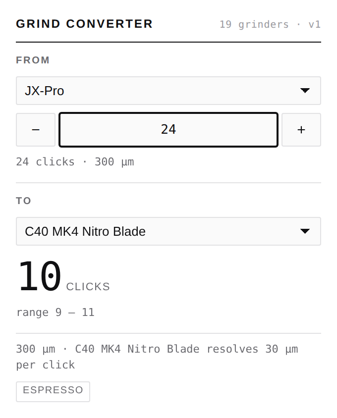

# Grind Converter

A Chrome extension that answers one question: *I grind at 24 clicks on my JX-Pro
— where do I set my C40?*

Pick the grinder you know, dial in your setting, pick the grinder you want, and
the extension shows the equivalent setting on it.

With a catalogue this size the picker is searchable: type a few characters of a
brand or model to narrow it, or browse by brand — groups start collapsed, and
the grinders you reached for last sit at the top.



## How it works

Grinder settings are not comparable across machines — a "click" means a
different burr gap on every model. Particle size is comparable, so every
conversion goes through microns:

```
setting on A  ->  microns  ->  setting on B
```

Each grinder carries a calibration describing that mapping. Two kinds cover the
market:

- **`linear`** — the burr gap moves a fixed distance per click. Most hand
  grinders publish this figure (JX-Pro: 12.5 µm/click, C40: 30 µm/click), and
  they zero at burr contact, so `microns = clicks × µm-per-click`.
- **`anchors`** — an arbitrary dial with no meaningful zero (Encore 1–40, Ode
  1–11). Measured reference points are interpolated piecewise-linearly. This
  also handles non-linear dials like the Encore ESP, whose steps get coarser
  past click 20.

### Honest precision

The converter never reports a number it cannot justify.

- The answer is **snapped to detents the target grinder actually has**. A dial
  with 30 µm steps cannot express 307 µm, so it does not pretend to.
- Every entry declares a **confidence** — `manufacturer`, `community`, or
  `estimated` — and conversions show an **uncertainty band** derived from both
  grinders' confidence, combined in quadrature.
- Pairings involving an `estimated` calibration say so in the UI.
- When the target physically cannot reach the requested grind size, it says that
  instead of silently clamping.

## Data

The dataset lives in [`packages/core/data/`](packages/core/data/) as reviewable
JSON, one file per brand. Every entry cites its sources; the build rejects
uncited entries.

The build reports its own size budget:

```
$ npm run build:data

  grinders        134
  brew methods    8
  confidence      manufacturer=11  community=120  estimated=3
  raw JSON        86.3 KB
  gzipped         9.5 KB
  per grinder     660 B raw
  projected 1000  644.4 KB raw, 71.2 KB gzipped
```

**This is why there is no backend.** At ~70 bytes gzipped per grinder, a
thousand-grinder catalogue is ~70 KB — smaller than a single product photo. It
ships inside the extension, so the converter works offline, needs no network
permission, and cannot leak what you grind.

The figure improves as the catalogue grows: a `linear` entry is two numbers
regardless of how much measurement went into it, so brands that publish a step
cost almost nothing to add.

If the catalogue ever outgrows that, the escape hatch is a static JSON file on a
CDN compared by `version`, not a server. Nothing here needs one.

### Growing the catalogue

Every path ends at the same place — a CSV in the shape `import-csv.mjs` reads —
so the schema, the validation and the provenance rules are shared no matter
where the numbers came from. The ingestion scripts live in `@coffee/core`; every
`node scripts/…` command below is run from `packages/core/`.

```
Google Sheets ──> scrape-sheets.mjs ─────┐
PDF tables ─────> pdf-table-to-csv.mjs ──┼──> twc-table-to-csv.mjs ──┐
                                         │                           ├─> import-csv.mjs ─> data/grinders/*.json
converter API ──> beeancoffee-harvest.mjs ───────────────────────────┘
```

Sources rarely publish microns. What they publish is a *correspondence* — this
setting on grinder A matches that setting on grinder B — which only becomes a
calibration once something in the chain carries an absolute particle size. Two
things can supply it: a grinder whose dial is marked in microns (the Mazzer ZM
appears in most published tables for exactly this reason), or a grinder whose
step is published and independently confirmed. Everything below is a way of
getting from a correspondence to a micron.

#### 1. Collect (`scripts/scrape-sheets.mjs`)

Many grinder write-ups publish their measurements as an embedded Google Sheet,
one per article. This walks a series, finds the sheets, and saves every tab as
CSV:

```bash
# from an index page that links the articles
node scripts/scrape-sheets.mjs \
  --index https://example.com/blog/series/ --path-contains /series/ \
  --out data/raw/series

# or from an explicit list, one URL per line
node scripts/scrape-sheets.mjs --urls articles.txt --out data/raw/series

# add --browser if the articles are rendered client-side
node scripts/scrape-sheets.mjs --urls articles.txt --out data/raw/series --browser
```

A browser is only needed to *discover* links on client-rendered pages —
downloading is a plain `export?format=csv` request, so the static path needs no
Playwright at all. If a static fetch finds no sheets, the script retries that
article through a browser by itself rather than reporting a false negative.

Two failure modes it refuses to paper over:

- **Multi-tab sheets.** `export?format=csv` without a `gid` returns *only the
  first tab*. The script reads the tab strip from `pubhtml`/`htmlview` first and
  exports each tab explicitly — otherwise a sheet with one tab per grinder comes
  back nearly empty and looks like it worked.
- **Private sheets.** A login wall answers `200` with an HTML page. Writing that
  to a `.csv` would poison the import, so HTML responses are reported instead.

Output is `<out>/*.csv` plus a `manifest.json` recording which article each sheet
came from, so provenance carries into the dataset's `sources`.

Only reaches sheets that are already publicly readable, runs sequentially with a
`--delay` between requests, and does not attempt to bypass any access control.
Check that the source's terms allow reuse before republishing its data; the
per-entry `sources` field exists so attribution survives.

#### 2. Recover tables from PDFs (`scripts/pdf-table-to-csv.mjs`)

Publishers migrate to PDF, and the PDF is often *newer* than the spreadsheet it
replaced — treating it as a duplicate silently loses whatever was added since.

```bash
pdftotext -bbox-layout table.pdf table.xml     # poppler
node scripts/pdf-table-to-csv.mjs table.xml --out data/raw/pdf
```

It reads word coordinates rather than `pdftotext -layout` text, because these
exports wrap long headings over several lines and poppler then groups
neighbouring cells into one block — "Niche Zero" and "Eureka Atom Pro" come back
interleaved as `Niche Eureka Zero Atom Pro`. Only the x coordinate says which
column a word belongs to.

Pages after the first usually drop the micron column and repeat one grinder as a
key instead; the scale is carried across through that column and the synthesised
values are labelled as such.

#### 3. Sweep a converter API (`scripts/beeancoffee-harvest.mjs`)

Some services convert between grinders without ever stating a particle size. A
micron scale is recovered by sweeping a *reference* grinder whose step is known
and reading off what the target says.

```bash
node scripts/beeancoffee-harvest.mjs --out bc.csv
```

**The reference is the whole ballgame.** Its error is baked into every entry
harvested through it, so it has to be a grinder whose published step is
confirmed by an independent measurement — not merely published. The default is
the Timemore Chestnut C2: the maker publishes 33 µm per click, and a sieve run
against a micron-dialled grinder agrees to within 1% over 55 readings. The
Comandante C40 was the other candidate and was rejected for sitting ~9% coarse
against that same sieve run.

Two behaviours worth knowing: such services extrapolate past the ends of a dial
rather than clamping — ask for something finer than the grinder reaches and you
get a negative click — and a fit is only trustworthy across the span actually
sampled, so the emitted scale is narrowed to that span rather than claiming the
untested ends.

#### 4. Map (`scripts/import-csv.mjs`)

Converts a spreadsheet into a validated data file:

```bash
node scripts/import-csv.mjs grinders.csv my-source --source https://example.com/db
npm run build:data
```

Columns: `brand, model, type, burr, min, max, step, unit,
microns_per_step, zero_offset` **or** `anchors` (`"1:300; 6:800; 11:1300"`),
plus optional `clicks_per_rotation, confidence, aliases, note, source`.
Rows without a usable calibration are reported and skipped, never guessed at.

### Cross-checking a source

A new source usually overlaps the catalogue. That overlap is free evidence, and
`--compare` spends it: it reports, per shared grinder, the ratio between what we
ship and what the source says.

```bash
node scripts/twc-table-to-csv.mjs data/raw/**/*.csv --compare src/generated/dataset.json
```

Read the *spread*, not just the median. Readings scattered around 1.0 are two
measurements of the same thing. A tight cluster sitting away from 1.0 is a slope
error — one of the two curves is simply wrong, and no amount of extra data
points will fix it. Errors found this way so far: a step copied from the
neighbouring model, a figure attributed to a manufacturer that its own
documentation contradicts, and a whole brand whose readings disagree with every
other source in both directions.

Compare against the catalogue *before* importing the source, or it will be
comparing the source with itself.

### Validation

`npm run check:data` goes past JSON well-formedness. It rejects duplicate ids,
uncited entries, scales whose step exceeds their range, anchors that do not
cover the scale they claim, and — most importantly — **non-monotonic
calibrations**, because the converter inverts these curves and a non-monotonic
one would make `microns → setting` ambiguous and silently wrong.

The unit suite adds invariants over the built dataset: no grinder may report
negative microns, or top out past ~2500 µm, or offer only a handful of
positions. These are the checks that catch a bad import, and they earn their
keep — an extrapolated fit that read −126 µm at zero, and another reaching
3288 µm, both looked entirely reasonable in the source CSV.

## Brew Journal on GitHub Pages (PWA)

The journal is a static website with a web app manifest and an offline service
worker. It needs no backend. Build it with `npm run build:journal` and publish
**`apps/journal/dist/`**; the default `npm run build` produces the Chrome extension.
All asset, manifest and worker paths are relative, so the same build works at
`https://yoshimuro.github.io/coffee-grinder-extension/` or a custom domain root.

To enable publication:

1. In the repository's **Settings → Pages → Build and deployment**, select
   **GitHub Actions** as the source.
2. Merge the reviewed changes into `main`. The **Deploy Brew Journal to Pages**
   workflow runs checks and publishes only after they pass. It also supports
   pushing a `pages-*` tag to publish a reviewed commit from another branch.
   **Run workflow** is available once the workflow exists on the repository's
   default branch; it accepts an explicitly selected ref. The `github-pages`
   environment must allow the chosen ref. Development branches do not publish
   on push.
3. Open the HTTPS URL reported by the deployment. Install through the browser's
   app menu, or **Share → Add to Home Screen** on iPhone/iPad.

The shell, local fonts, manifest and icons are available offline after a
successful first visit. Journal data stays in the browser's IndexedDB; use the
app's database export to back it up or transfer it to another device. The web
version does not implement the APK's speech input or scheduled reminders.

Saved entries, recipes, shelf, equipment and settings live in IndexedDB;
full-size browser photos live in OPFS (or a stored data URL where OPFS writing
is unsupported). These are disk storage, separate from cached application
files. Reloading or restarting the browser does not reset them. Clearing only
cached files does not delete the journal; clearing **site data** does.
Unsaved forms and an unfinished timer are in-memory state and are not restored.

On production startup the app requests persistent storage. **Settings → Data
storage** reports the browser's actual decision and allows retrying a declined
request. A granted request protects against automatic storage eviction, not
explicit site-data deletion. The browser may decline it; private browsing,
storage pressure and browser policies mean there is no unconditional promise
of keeping browser-local data forever. Keep a database export for recovery.
See [browser storage rules](https://developer.mozilla.org/en-US/docs/Web/API/Storage_API/Storage_quotas_and_eviction_criteria).

Updates download a complete new shell before becoming eligible for activation.
Close all tabs/windows of the journal and reopen it to switch to a downloaded
update; an active timer or unsaved form is not reloaded automatically. A failed
download retains the previous version. Cache cleanup is limited to this app's
URL scope, leaving other Pages projects on the same origin alone.

The phone layout keeps bottom navigation; tablet and desktop layouts use a
sidebar, bounded form widths, and (on desktop) a two-column coffee shelf.

Local release checks:

```bash
npm ci
npx playwright install chromium webkit
npm run verify:journal
```

`test:production:journal` expects a current `build:journal`. It serves the actual
build under `/coffee-grinder-extension/`, checks offline data/assets, successful
and interrupted updates, cache isolation, and responsive flows at 320, 393,
768, 1280 px and in landscape, plus an emulated iPhone in WebKit. These checks
also run in CI; final home-screen installation should be checked on real phones.
Persistent-profile tests in Chromium and WebKit additionally save records and
photos offline, restart the browser process using the same on-disk profile,
and compare every database field and photo hash. They also check cache-only
clearing. Playwright is pinned to 1.64.1, which includes the WebKit persistent
cache fix ([issue #41618](https://github.com/microsoft/playwright/issues/41618)).
WebKit checks refuse connections at the origin; Chromium additionally enables
browser offline emulation. Both restart cases run locally and in Linux CI.
A physical phone reboot is not simulated by these tests.

## Brew Journal for Android

Install the latest signed build straight from the phone:

**[⬇ brew-journal.apk](https://github.com/yoshimuro/coffee-grinder-extension/releases/download/android-latest/brew-journal.apk)** — or browse
[all releases](https://github.com/yoshimuro/coffee-grinder-extension/releases).

Open the downloaded file and allow installation from this source when Android
asks; there is no Play Store listing. Later builds install over earlier ones
without an uninstall, because every APK published here is signed with the same
key.

One install cannot be updated in place: the `apk/brew-journal-debug.apk` that
used to sit in the tree was a debug build, signed with a per-machine throwaway
key. Android refuses a differently signed APK over an installed one — the
installer just says the app was not installed — so that one has to be
uninstalled first (export the journal from **ЕЩЁ → ЭКСПОРТ БАЗЫ В ФАЙЛ** before
doing it; uninstalling takes the local database with it). Everything published
since is on the stable key.

That key lives in the repo at `apps/journal/android/keystore/sideload.jks`
(password `sideload`) and is deliberately public. It exists to keep the
signature stable across sideloaded builds — it is not a publishing identity, and
anything destined for the Play Store needs a private keystore instead, supplied
through `ANDROID_KEYSTORE_PATH`, `ANDROID_KEYSTORE_PASSWORD`, `ANDROID_KEY_ALIAS`
and `ANDROID_KEY_PASSWORD`. Debug builds are signed with the same sideload key
and never with `~/.android/debug.keystore`, so an APK off a laptop and an APK off
CI remain interchangeable on one phone.

### Versioning

`versionName` and `versionCode` both come from `apps/journal/package.json`, the
one place the app's version is written down; `versionCode` is
`MAJOR*10000 + MINOR*100 + PATCH` (0.2.0 → `200`). The second half of an install
failure is a version that went backwards — Android rejects an update whose
`versionCode` is below the installed one, and that rejection looks exactly like a
signature clash. Deriving the number from the version instead of from a build
counter is what keeps it monotonic: two builds of the same version share a code
(equal codes install fine), and it only climbs when the version does. A local
build lands on the same numbers as the CI build of the same commit.

`.github/workflows/release-apk.yml` builds the APK. A push to `main` (or to a
`claude/**` branch) refreshes the rolling `android-latest` release the link above
points at — so that link can serve a preview build; the release notes say which
ref it came from. Pushing a `v*` tag publishes a permanent release for that
version, and the tag has to match `apps/journal/package.json` or the build fails.
All rolling builds share one concurrency group, so the newest push wins the
asset rather than two branches racing and leaving the older APK in place.

Building one locally, with the Android SDK installed:

```bash
npm run build:journal
cd apps/journal && npx cap sync android
cd android && ./gradlew assembleRelease   # -> app/build/outputs/apk/release/
```

## Development

The repo is an npm-workspaces monorepo. Every command below is run from the
root; the root scripts delegate to the workspace that owns the step.

```bash
npm install
npm run build          # -> apps/extension/dist/
npm run verify         # data + typecheck + unit + build + e2e
```

Load `apps/extension/dist/` via `chrome://extensions` → Developer mode →
*Load unpacked*.

### Tests

- **Unit** (`packages/core/tests/unit`, Vitest) — the conversion maths:
  round-tripping, snapping, extrapolation, band widening, and invariants across
  the shipped dataset (every grinder monotonic, within a plausible micron range,
  and offering more than a handful of positions). The extension keeps its own
  unit suite in `apps/extension/tests/unit` for the prefs store.
- **E2E** (`apps/extension/tests/e2e`, Playwright) — a real Chromium with the
  real unpacked extension loaded, driving the real popup.

Two things make the E2E suite work that are worth knowing before touching it:

1. The manifest pins a public `key`, which fixes the unpacked extension ID.
   Playwright blocks `chrome://extensions`, so tests derive the ID from that key
   and address `chrome-extension://` URLs directly.
2. The fixtures request `channel: 'chromium'`. Playwright's default headless
   build is `chromium_headless_shell`, which **silently ignores
   `--load-extension`** — the suite would launch, find nothing, and fail with
   `ERR_ABORTED`.

### Layout

```
packages/core/                 @coffee/core — the engine, shared by every app
  src/                         pure conversion + dataset access, no DOM, no chrome APIs
  src/index.ts                 the package's public surface
  src/generated/               built dataset (checked in; CI verifies it matches data/)
  data/grinders/               reviewable source data, one file per brand or per source
  data/raw/                    scraped material, gitignored; provenance lives in each entry
  scripts/                     dataset build and ingestion
  tests/unit/                  conversion maths + dataset invariants (Vitest)

apps/extension/                @coffee/extension — the Chrome extension
  src/                         popup markup, styles, controller, prefs, manifest
  scripts/screenshot.mjs       renders the popup states into docs/screens/
  tests/unit/                  prefs store (Vitest)
  tests/e2e/                   real Chromium against the real unpacked build (Playwright)
  dist/                        build output, gitignored

apps/journal/                  @coffee/journal — the Brew Journal app (BJ-2)
```

Ingestion scripts, in the order data flows through them:

```
scrape-sheets.mjs        collect Google Sheets linked from a blog series
pdf-table-to-csv.mjs     recover a table from a PDF via word coordinates
twc-table-to-csv.mjs     grinder-per-column tables -> import shape; --compare
beeancoffee-harvest.mjs  sweep a converter API against a known reference
import-csv.mjs           validated CSV -> data/grinders/*.json
build-dataset.mjs        data/ -> src/generated/dataset.json, with the checks
```

`data/raw/` is deliberately not committed. Nothing downstream reads it at build
time — it is the working material an import was derived from, and re-running one
means re-fetching, which is the honest behaviour anyway since the sources
change. What has to survive is the attribution, and that lives in each entry's
`sources`.

`@coffee/core` has no dependency on `chrome.*` or the DOM — its `tsconfig` drops
the DOM lib outright, so a stray `document` is a compile error — which is what
makes the conversion logic testable in plain Node and reusable outside the
extension. Apps import it as `@coffee/core`, never by relative path.

## Preferences

The last source grinder, target grinder and setting are stored in
`chrome.storage.local`. No account, no sync, no network — it is scoped to the
browser profile and never leaves the machine.

## Licence

MIT. Grinder specifications are factual data drawn from manufacturer
documentation and public references, cited per entry in `data/`.
